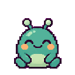

# Tippy sprite pack

Original pixel art of a teal pond creature and objects for its camp. Each sprite
is a separate 256 × 256 RGBA PNG with a transparent background.

| Folder | Sprites |
| --- | --- |
| `Pet/` | `thriving`, `happy`, `okay`, `concerned`, `waiting`, `egg` |
| `Rewards/` | `coin` |
| `Camp/` | `sprout`, `mushroom`, `watering-can`, `lantern`, `seashell` |
| `Drinks/` | `water`, `beer`, `wine`, `cocktail` |

The five mood filenames match the raw values of `PetMood` in
`Modules/TippyModeration`. Keep their canvas padding when swapping moods so
the poses stay aligned. Use nearest-neighbor scaling to preserve the pixel
edges (`.interpolation(.none)` in SwiftUI).

These are source assets under `Assets/`. To use a sprite at runtime, add it
to the app target's resources and load it from that resource bundle.

## Animations

Each PNG strip has four transparent 128 × 128 frames in a single row.
Read left to right, starting at x = 0, 128, 256, and 384. The GIFs show
the loops at their intended speed.

| Strip | Frame durations (ms) | Preview |
| --- | --- | --- |
| `pet-idle.png` | 480, 160, 250, 160 |  |
| `pet-hop.png` | 480, 100, 160, 110 |  |
| `coin-shimmer.png` | 250, 100, 120, 100 |  |

## App icon

[`Assets/DefaultIcon.png`](../DefaultIcon.png) is the matching opaque 1024 ×
1024 icon. The existing build script uses it when the optional private icon
is unavailable.
